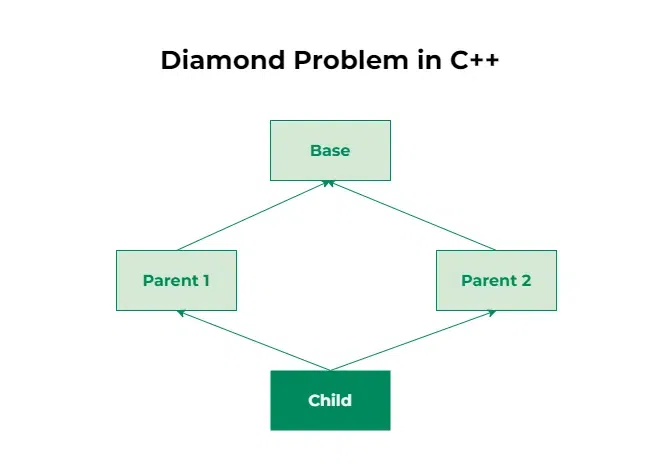

???+ "Encapsulation"
    - Definition: Encapsulation is bundling data and the methods that operaton on that data within a class, while controlling access to the data using access modifiers to maintain its integrity.

    - External code accesses them through public methods, often referred to as getters and setters. 

    - It allows the class to control how data is accessed or modified.
    - Data hiding: Making variables private/protected so they can't be accessed directly from outside the class.
    - Getters/Setters: Public methods that provide controlled read/write access to private data (can add validation logic).
    
    - Benefits: Protects data integrity, allows internal implementation to change without breaking external code, improves security/maintainability.  

???+ "Abstraction"
    - Definition: Abstraction is the process of hiding unnecessary implementation details and exposing only the essential functionality of an object.
    - Abstract class: A class that cannot be instantiated, may have both abstract (unimplemented) and concrete methods. Forces subclasses to implement the abstract ones.
    - Interface: A fully abstract contract — only method signatures, no implementation (in most languages). A class can implement multiple interfaces.

???+ "Inheritence"
    - Definition: Inheritence is an OOP mechanism that allows the creation of new classes that inherit properties and methods of existing classes. 
    - It promotes code reuse and establishes a hierarchical relationship between classes.
    - Parent/Base/Super class: the class being inherited from.
    - Child/Derived/Sub class: the class that inherits.
    - Types:
        - Single: one child ← one parent
        - Multiple: one child ← multiple parents (C++ supports; Java/C# don't allow for classes — use interfaces instead)
        - Multilevel: chain — A ← B ← C
        - Hierarchical: multiple children ← one parent
        - Hybrid: combination of two or more types above (e.g., hierarchical + multiple)
    - Advantages: code reusability, extensibility, supports polymorphism.
    - Multiple inheritance can cause ambiguity (Diamond Problem).

          
      - In simple words:
		- A child class inherits from two parent classes
		- Both parent classes already inherit from the same base class
		- So the child class gets two copies of the same base class, creating confusion (ambiguity)
      - Diamond problem arise in languages where multiple inheritence is allowed. In c++ multiple inheritence is allowed, so it can arise there. But it can be resolved using virtual inheritence. In java, interface allows multiple inheritence. If we have default method in inheritence, then it must has to be implemented (provide body to the method). In that case diamond problem can arise. 
	
	
	```java
		interface A {
			default void show() {
				System.out.println("A");
			}
		}

		interface B extends A {
			default void show() {
				System.out.println("B");
			}
		}

		interface C extends A {
			default void show() {
				System.out.println("C");
			}
		}

		class D implements B, C {
			// Must resolve the conflict
			@Override
			public void show() {
				B.super.show();
			}
		}
	```

	- Constructors are not inherited by child classes. The child has its own constructors.

	??? "Constructor running order in inheritence [Constructor chaining]"
		- Parent’s constructor always runs first when a child object is created. 
		```java
			class Animal {
    			Animal() {
        			System.out.println("1. Animal constructor");
    			}
			}

			class Dog extends Animal {
				Dog() {
					System.out.println("2. Dog constructor");
				}
			}

			class Puppy extends Dog {
				Puppy() {
					System.out.println("3. Puppy constructor");
				}
			}
		```
		Now if we create a Puppy object: 
		```Puppy p = new Puppy();``` then outputs: 
		```
			1. Animal constructor
			2. Dog constructor
			3. Puppy constructor
		```
		Basically Java writes a implicit line at the top in childs constructor : super(); This super() method calls the parent constructor. 
		```java
			class Dog extends Animal {
				Dog() {
					super(); // Java puts this line even if we don't
					System.out.println("Dog");
				}
			}
		```
		The parent constructor must be invoked before the child construcotor body executes.

		The below code is not correct: 
		```java
			class Dog extends Animal {
				Dog() {
					System.out.println("Dog");
					super();   // ERROR
				}
			}	
		```

		??? "A Contructor rule"
			When we don’t write any constructor, java automatically provides a no-argument constructor. 

			But when we write a constructor, maybe a parameterized one, then java does not write any non-parameterized constructor:

			```java
			class Animal {
    			Animal(String name) {
    			}
			}
			```
			Now java does not provide an automatic non-argument constructor
		
		??? "Another constructor rule"
			```java
				class Animal {
					Animal(String name) {
						System.out.println(name);
					}
				}

				class Dog extends Animal {
					Dog() {
						System.out.println("Dog");
					}
				}
			```
			This code won’t compile. 
			Because child’s constructor will invoke parents’ constructor implicitly: 
			
			```java
			class Dog extends Animal {
				Dog() {
					super(); // error
					System.out.println("Dog");
				}
			}
			```
			But in the parent class there is no constructor without parameter. So to run this code we have to send a parameter when calling parent’s constructor: 
			```java
			class Dog extends Animal {
				Dog() {
					super("buddy");
					System.out.println("Dog");
				}
			}	
			```

???+ "Polymorphism"
	- Definition: Polymorphism means many forms. It allows the same method to have different behaviors depending on the object.

	- Because of polymorphism same method/interface behaves differently based on the object (e.g., method overriding/overloading).

	There are two types of polymorphism
		- Compile time polymorphism (Method overloading)and Runtime polymorphism (Method overriding)

	??? "Method Overloading (Compile time polymorphism)"
		Overloading occurs when multiple methods in the same class have the same name, but different parameters (different types, number, or sequence of arguments).
		```java
			class Calculator {
				// Method 1: Adds two integers
				int add(int a, int b) {
					return a + b;
				}

				// Overloaded Method 2: Adds three integers
				int add(int a, int b, int c) {
					return a + b + c;
				}

				// Overloaded Method 3: Adds two double values
				double add(double a, double b) {
					return a + b;
				}
			}
		```	
	??? "Method Overriding (Run-time polymorphism)"
		Overriding occurs when a subclass (child class) provides its own specific implementation of a method that is already defined in its superclass (parent class). The method in both classes must have the exact same name, return type, and parameters

		```java
			// Parent Class
			class Animal {
				void makeSound() {
					System.out.println("Animal makes a sound");
				}
			}

			// Child Class overriding parent method
			class Dog extends Animal {
				@Override
				void makeSound() {
					System.out.println("Dog barks"); // Custom behavior
				}
			}
		```
	??? "Overloading VS Overriding"
		| Feature | Method Overloading | Method Overriding |
		| :--- | :--- | :--- |
		| **Relationship** | Occurs within the same class. | Occurs between parent and child classes (Inheritance). |
		| **Method Signature** | Method name is same, but parameters must be different. | Method name, return type, and parameters must be identical. |
		| **Polymorphism Type** | Compile-time (Static) polymorphism. | Run-time (Dynamic) polymorphism. |
		| **Return Type** | Can be same or different. | Must be the same (or a covariant subtype). |
		| **Private/Static Methods** | Can be overloaded. | Cannot be overridden (static methods use shadowing/hiding). |
		| **Main Goal** | Increases readability by using one method name for different data types. | Provides a specific implementation for an inherited method. |


???+ "Example of oop in code (java)"
	```java
		class Animal{
		private String name; // Encapsulation
		public Animal(String name){
			this.name = name;
		}
		public String getName(){
			return name;
		}
		
		abstract void makeSound(); // Abstraction
		}

		class Dog extends Animal{ // Inheritence
		public Dog(String name){
			super(name);
		}
		
			@Override // polymorphism
			void makeSound(){
				System.out.println("Dog barks");	
			}
		}
	```